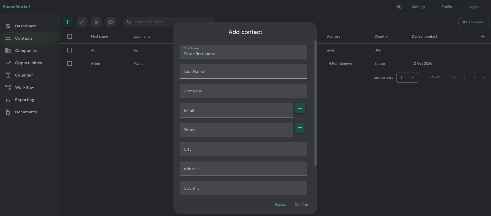

# SpaceMarket

SpaceMarket is a CRM project using **Angular 20**, **Java 25 Spring Boot 3.5**, and **PostgreSQL**.

## Prerequisites

- **Docker**, running. The backend's tests and demo mode start a throwaway PostgreSQL in it; nothing else to install for the database.
- **JDK 25** and **Node.js**.

## Installation

1. Go to the root project folder (`SpaceMarket`).

2. To run both the backend and frontend ; 

    a. Open a terminal 
    
    b. Run this command: **node start.js**

    The backend starts against a fresh PostgreSQL filled with demo data (`back/src/main/resources/data.sql`). It is thrown away when you stop it. To run only the backend this way, launch `TestBackApplication` from your IDE or run `mvn spring-boot:test-run` in `back/`.

3. Login with ;

    email : test5@test.com 
    
    password : 12345678

## Running against your own database

Without `TestBackApplication`, the backend uses the `dev` profile: a local PostgreSQL database named `spacemarket` (see `back/src/main/resources/application-dev.properties`). Its data is kept between runs, and the demo data is not loaded.

## Seeing errors while developing (Spotlight)

Run `npm run spotlight` in `front/`, then open http://localhost:8969. Errors from the backend (`dev` profile) and from the frontend (`npm start`) show up there. Everything stays on your machine: nothing is sent to Sentry's servers, and production reports nothing.

## Tests

- Backend: `mvn test` in `back/` (needs Docker).
- Frontend: `npm test` in `front/` (needs Chrome, or `CHROME_BIN` pointing to another Chromium browser).
